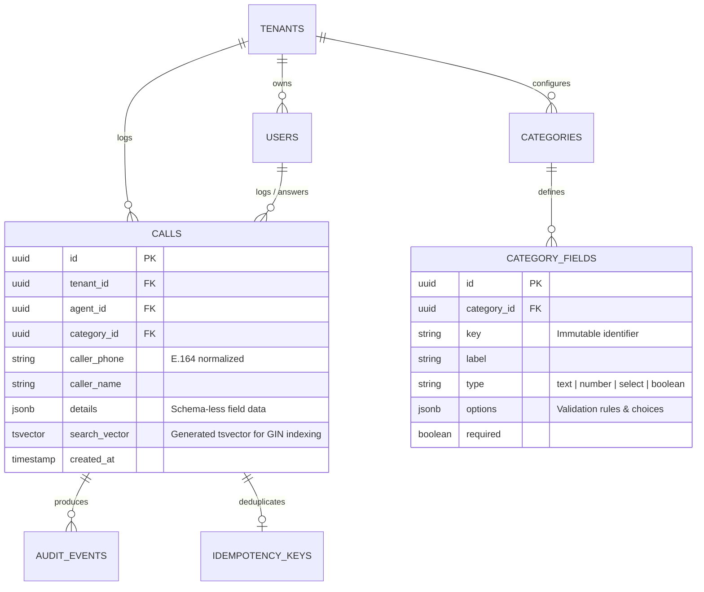
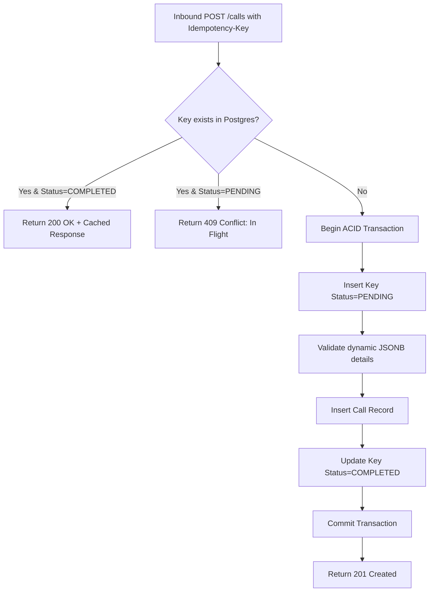

# Nexora — Deep-Dive System Architecture Specification

This document provides a comprehensive technical architecture specification for the **Nexora Enterprise Contact Centre** platform. It outlines internal component isolation, failure mode behaviors, data schema modeling, and scalability boundaries.

---

## 1. Domain Model & PostgreSQL Data Architecture

The persistence model resolves a classic tension in contact centre engineering: **Relational Integrity vs. Unpredictable Custom Attributes**.



### The JSONB + Generated TSVector Strategy
1. **Dynamic JSONB `details`:** Form field definitions can be updated or reordered by supervisors in seconds. Older call logs maintain their exact historical keys and values without data corruption.
2. **PostgreSQL Generated Full-Text Column:**
   ```sql
   search_vector tsvector GENERATED ALWAYS AS (
       setweight(to_tsvector('english', coalesce(caller_name, '')), 'A') ||
       setweight(to_tsvector('english', coalesce(caller_phone, '')), 'B') ||
       setweight(to_tsvector('english', coalesce(notes, '')), 'C')
   ) STORED;
   ```
   A **GIN (Generalized Inverted Index)** on `search_vector` keeps search fast as call records grow, without scanning the table.

---

## 2. Failure Mode Analysis (Resilience Matrix)

The system design enforces the principle of **Graceful Degradation Under Failure**:

| Subsystem | Failure Scenario | System Behavior & Mitigation |
|---|---|---|
| **Redis Cache** | Node crash or out-of-memory eviction | **Fails Open.** Rate limiting permits requests; live dashboard falls back to polling; no call data is lost. |
| **Network Flap** | Connection drop during call submission | **Idempotent Retry.** Client retries with the same `Idempotency-Key`; server safely returns the committed call ID without duplicating. |
| **Autosave** | Client draft synchronization fails | **Silent Drop.** Fails quietly in the background without throwing intrusive UI popups over an active agent conversation. |
| **Phone Input** | Malformed / international phone number | **Safe Fallback.** Falls back to unnormalized string storage rather than rejecting the submission mid-call. |

---

## 3. High-Concurrency Idempotency Flow

To prevent double-logging from rapid agent clicks or automated network retries:



---

## 4. Multi-Tenant Query Isolation

Multi-tenancy is enforced through programmatic query scoping at the data layer:
- Every query automatically injects the authenticated user's `tenantId` extracted from their validated JWT.
- Cross-tenant data leakage is prevented without requiring complex, expensive multi-database provisioning.

---

## 5. Scalability Roadmap

1. **Phase 1 (1–50 Agents, <10k calls/day):** Single VPS with Docker Compose (PostgreSQL 16, Redis 7, NestJS API, Next.js Web).
2. **Phase 2 (50–500 Agents, <200k calls/day):** Managed PostgreSQL (with Read Replica dedicated to supervisor analytics) and external Redis cluster.
3. **Phase 3 (Enterprise Scale, Millions of calls):** Monthly PostgreSQL table partitioning on `calls` (`PARTITION BY RANGE (created_at)`), ensuring index trees remain cached in RAM.
