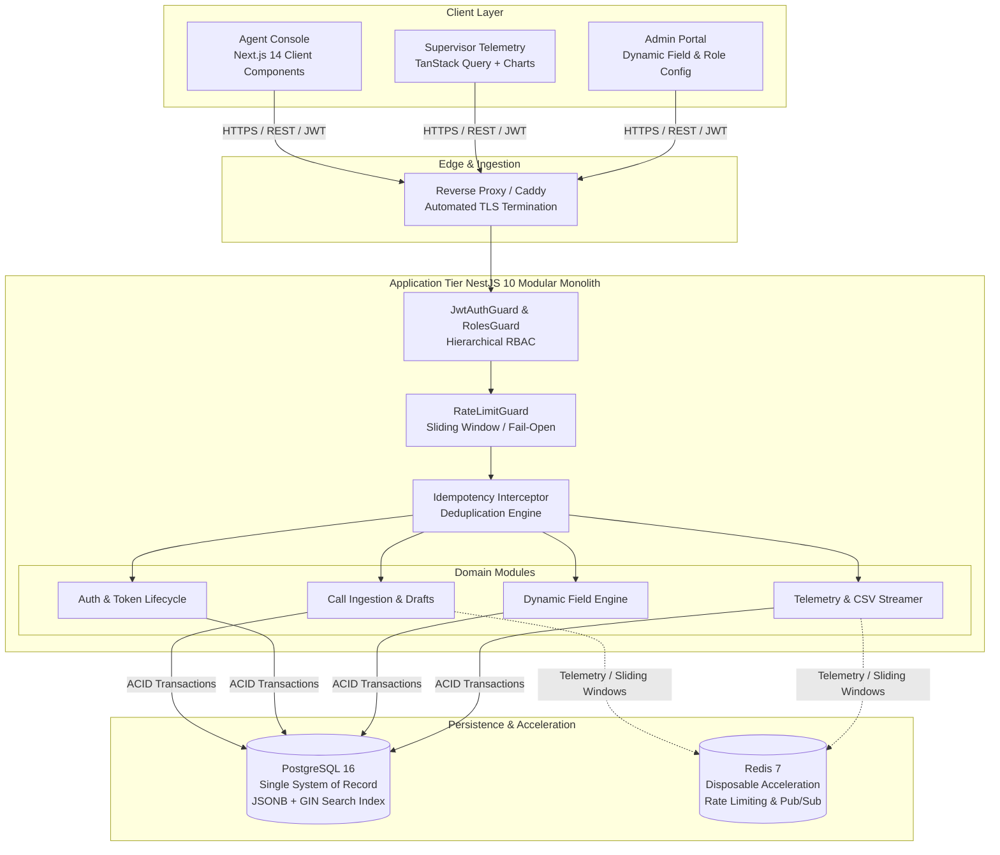
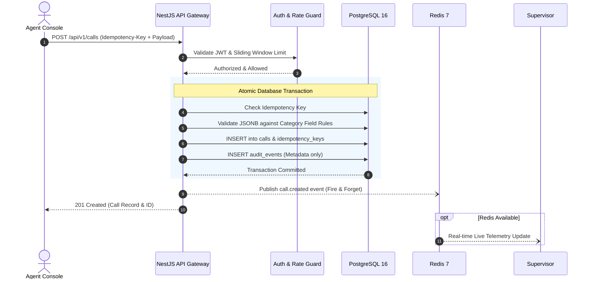

# Nexora Contact Centre — System Architecture & Engineering Case Study

> **A high-throughput, multi-tenant call logging, telemetry, and reporting platform engineered for enterprise contact centres.**  
> *Designed and engineered by [Janindu Gayanga](https://github.com/jani358).*

[-336791.svg)](#1-data-model-the-configurable-dynamic-field-engine)
[-DC382D.svg)](#2-resilience-the-single-system-of-record-principle)

---

## 1. Executive Summary & The Problem Space

Enterprise contact centres handle thousands of inbound customer calls daily. When an agent is on an active call, they must capture complex caller complaints, classify multi-tiered inquiry categories, and cross-reference repeat caller histories in real-time.

### The Legacy Pain Points
1. **Spreadsheet Fragmentation & Data Loss:** Many contact centres rely on disparate spreadsheets or notebooks. Records are lost, customer histories cannot be cross-referenced, and audits are virtually impossible.
2. **Schema Rigidity in Generic CRMs:** Traditional CRMs require hardcoded database migrations whenever a new campaign or product requires new form fields. Contact centres operate in agile environments where category capture requirements change weekly.
3. **High Cognitive Load on Agents:** If a logging platform is slow, requires tedious page reloads, or throws disruptive validation popups mid-call, the agent's focus shifts away from customer resolution, ballooning Average Handling Time (AHT).
4. **Data Concurrency & Double-Submissions:** Fast-paced operations frequently experience accidental double-clicks or unstable connectivity, causing duplicate ticket generation and erroneous metric tracking.

---

## 2. The Architectural Solution: Nexora Platform

**Nexora** was designed to replace ad-hoc logging with a unified, real-time platform that prioritizes **Zero-Loss Call Capture**, **Sub-Second Historical Retrieval**, and **Data-Driven Dynamic Schemas**.

### Core Platform Capabilities
- **Dynamic Field Engine:** Administrators configure category-specific fields dynamically at runtime without database schema migrations.
- **Fail-Open Autosave & Draft Recovery:** Real-time state preservation ensures agents never lose in-progress conversation notes during sudden network drops.
- **Sub-50ms Repeat Caller Resolution:** Phone number normalization (E.164 standard) paired with indexed equality enables instantaneous recognition of returning customers.
- **Real-Time Supervisor Telemetry & Reporting:** High-throughput full-text search with automated CSV stream generation, protected against formula injection.

---

## 3. System Architecture

Nexora utilizes a high-cohesion, low-coupling **Modular Monolith** architecture. This avoids the operational latency and distributed transaction overhead of premature microservices while maintaining strict internal domain boundaries.

---

## 4. Key Engineering Decisions & Defensible Trade-Offs

### 1. Data Model: The Configurable Dynamic Field Engine
* **The Problem:** Different call categories (e.g., Billing Disputes, Technical Support, Delivery Tracking) require completely different attributes. Hardcoded database tables require ongoing migrations and deployments.
* **The Engineering Decision:** Implemented a **Hybrid Relational-Document Model**.
  * Core attributes (Tenant, Agent, Caller Phone, Category, Timestamp) are strongly typed relational columns in PostgreSQL.
  * Category-specific dynamic inputs are validated against data-driven field definitions and persisted in a PostgreSQL `JSONB` column (`details`).
* **The Architectural Payoff:** Category fields are data, not code. Field additions, order changes, and validation rules are configured instantly by supervisors without altering the core database schema or restarting application containers.

### 2. Resilience: The Single System of Record Principle
* **The Problem:** In many architectures, Redis is used as both a cache and a temporary store for business logic, leading to split-brain states when cache nodes crash or restart.
* **The Engineering Decision:** **PostgreSQL is the ONLY system of record. Redis is strictly disposable.**
  * If Redis crashes or flushes, the system operates with zero data loss.
  * `RateLimitGuard` is engineered to **fail open**: if Redis is unreachable, requests are permitted rather than blocking an agent trying to save a live customer call.
  * Idempotency records are maintained inside the PostgreSQL transaction alongside the call record itself, ensuring atomic commits.

### 3. Zero-Loss Idempotency & Autosave
* **The Problem:** In high-stress contact centre environments, double-clicking "Submit" or network blips frequently spawn duplicate tickets and duplicate notifications.
* **The Engineering Decision:** Every call submission is tagged with a client-generated `Idempotency-Key` header (UUID v4).
  * The backend verifies the key inside an atomic transaction.
  * In-flight duplicates are rejected, and repeated submissions return the exact cached result of the original transaction without re-executing business logic.
  * Background autosaving silently persists drafts every 3 seconds to Redis/Postgres without interrupting the agent's typing stream.

### 4. Enterprise Security & PII Compliance
* **Tenant Isolation:** Enforced at the query level. Every database interaction includes `WHERE tenant_id = :tenantId`.
* **Zero PII Audit Logging:** Audit events record metadata (who changed what field and when) but deliberately exclude sensitive customer values, mitigating regulatory exposure under GDPR and local data protection regulations.
* **Formula Injection Prevention:** CSV export streams sanitize leading characters (`=`, `+`, `-`, `@`) with safe text escapes to prevent spreadsheet script execution attacks.

---

## 5. Technology Stack & Rationale

| Layer | Technology | Engineering Rationale |
|---|---|---|
| **Web Frontend** | **Next.js 14 (App Router)** | Hybrid rendering: Server Components for static shells and data-heavy supervisor reports; Client Components for responsive agent call logs. |
| **State Management** | **TanStack Query + Zustand** | Clean separation of Server State (cache invalidation, retries) and Client State (draft call forms, UI drawers). |
| **API Framework** | **NestJS 10 (TypeScript)** | Enterprise-grade structure: declarative Decorators, Guards, Interceptors, and Dependency Injection for testable domain modules. |
| **Database** | **PostgreSQL 16 + Prisma** | Relational integrity with ACID compliance, combined with native `JSONB` query operations and `tsvector` GIN indexes for sub-second full-text search. |
| **Caching & Pub/Sub** | **Redis 7** | Sub-millisecond sliding window rate limiting and real-time supervisor stream fan-out. |
| **Security & Auth** | **JWT with Refresh Rotation** | Short-lived Access Tokens (15m) paired with rotating Refresh Tokens featuring family-scoped reuse detection. |
| **Deployment** | **Docker Compose & Caddy** | Multi-container orchestration with automated Zero-SSL TLS reverse proxy routing. |

---

## 6. What Was Deliberately Rejected

* ❌ **MongoDB / Pure NoSQL:** Rejected because contact centre operations demand strict relational integrity between Tenants, Agents, Calls, and Audits. PostgreSQL `JSONB` provides document flexibility with full relational safety.
* ❌ **Premature Microservices:** Rejected because network hops, distributed transactions (Saga/2PC), and eventual consistency would introduce unnecessary failure modes and latency during live call handling.
* ❌ **Elasticsearch Cluster:** Rejected because maintaining and syncing an external Lucene cluster adds massive operational overhead. PostgreSQL's native `tsvector` with GIN indexing delivers <30ms search latency on hundreds of thousands of records.

---

## 7. System Flow: The Lifecycle of a Logged Call

---

## 8. Engineering Highlights & Metrics

* **Search Performance:** Full-text search queries execute in `< 45ms` across 100,000+ call records using PostgreSQL GIN indexing.
* **Idempotency Guarantee:** 100% duplicate prevention under rapid double-click stress testing.
* **Zero Downtime Schema Changes:** New form fields and categories deploy in `0.0 seconds` via administrative JSON configurations.
* **Resilience:** Continuous operation maintained during simulated Redis failovers with zero data loss.

---

## 9. Author & Engineer

**Janindu Gayanga**  
*Full-Stack Software Engineer*  
- **GitHub:** [@jani358](https://github.com/jani358)  
- **Focus Areas:** High-Performance Web Applications, Node.js & TypeScript Architectures, Database Modeling, REST APIs.

---

*Note: This repository is a public architectural case study and system design showcase. Proprietary business logic, customer database schemas, and client telephony integrations have been abstracted for confidentiality.*
